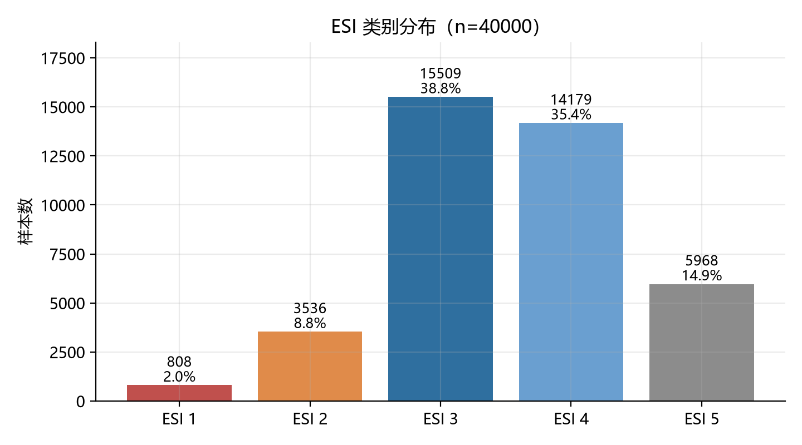
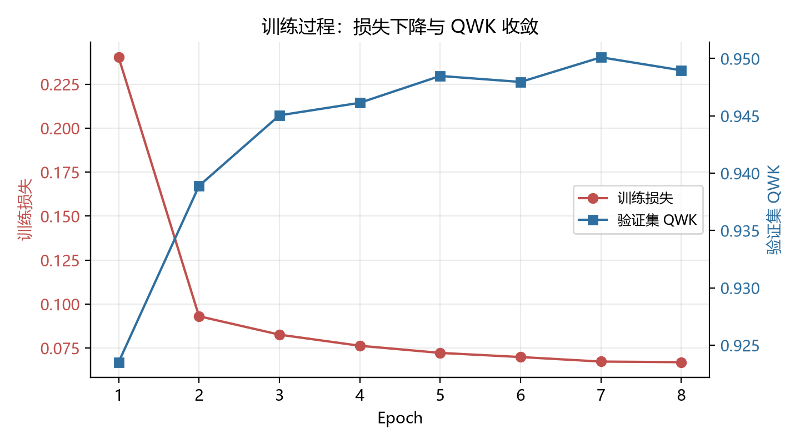
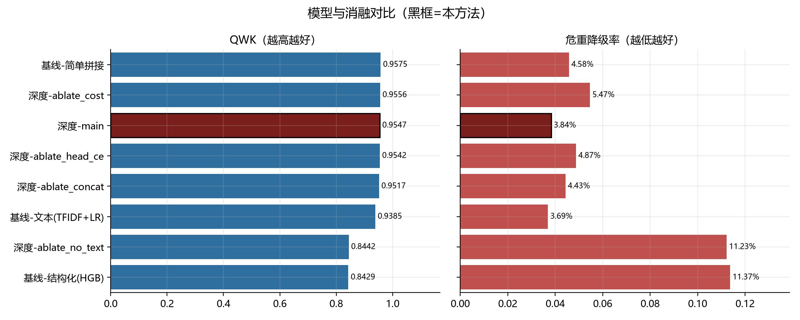
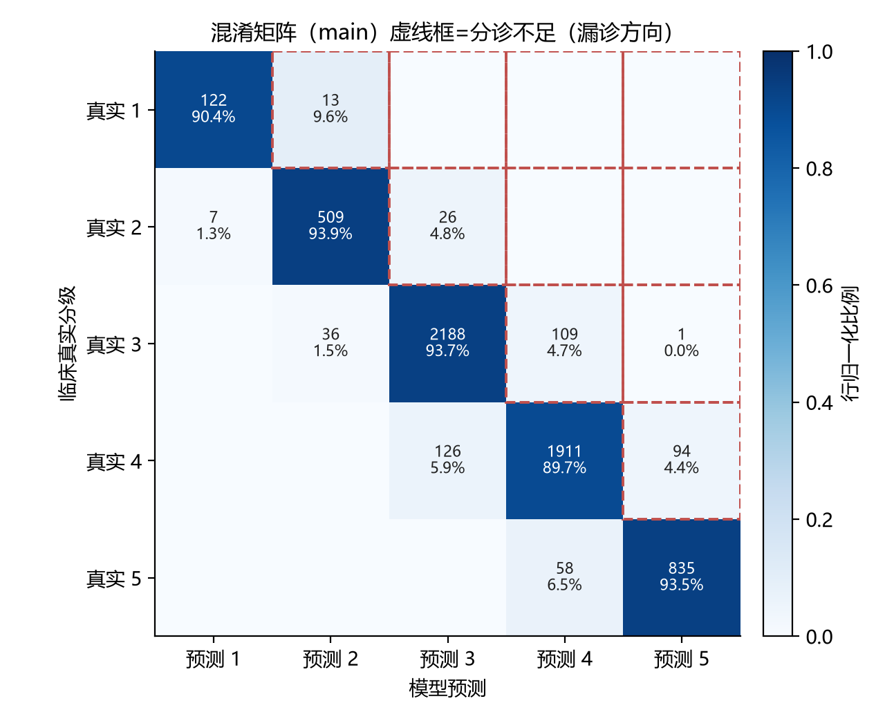
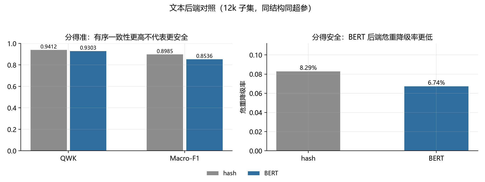

# 基于双塔融合与序数回归的急诊分诊分级模型

**——补齐开源医疗 OS 的分诊 AI 服务**

> 深度学习课程设计报告

---

## 摘要

急诊分诊需要在患者到达后数分钟内完成 ESI（Emergency Severity Index）1–5 级评定，其错误后果高度不对称：把危重患者判轻会延误抢救，把轻症判重只浪费资源。本文实现了一个可训练、可评估、可服务的分诊分级模型：以生命体征等结构化特征与主诉文本构成双塔输入，经门控融合后由 CORAL 序数回归头输出 5 级概率分布，并以不对称代价矩阵对齐临床风险。评估使用二次加权 Kappa（QWK）、macro-F1、危重降级率与代价加权误差四项指标，按患者划分训练/验证/测试集以避免同一患者跨集泄漏。

在 40,000 条合成数据上（17,200 位患者，测试集 6,035 条），模型取得 QWK 0.9547（95% CI 0.9505–0.9588）、macro-F1 0.9220、危重降级率 3.84%。消融显示主诉文本是主要信息源（去掉后 QWK 降至 0.8442、危重降级率升至 11.23%），CORAL 相比交叉熵在同条件下降低危重降级率。系统以 FastAPI 提供服务、Gradio 提供演示界面，接口沿用开源医疗 OS 的契约但返回真实概率分布。

**关键词**：急诊分诊；ESI；双塔融合；CORAL；序数回归；代价敏感学习

---

## 一、绪论

### 1.1 背景与问题

急诊科的核心矛盾是资源有限而需求不可预测。分诊护士在患者到达后的数分钟内，依据主诉、生命体征与经验给出 ESI 分级，该分级直接决定就诊顺序、床位分配与是否启动绿色通道。

分诊错误的代价是不对称的：

- **危重降级（under-triage）**：真实 ESI 1 被判定为 ESI 4，患者进入普通候诊区，可能错过抢救窗口；
- **轻症升级（over-triage）**：真实 ESI 4 被判定为 ESI 1，占用抢救资源，但患者不会因等待而恶化。

因此，一个只追求"分类准确率"的模型在这里是危险的：在危重样本仅占 10.8% 的分布下，模型把所有样本判为 ESI 3–4 也能获得可观的准确率，却会把真正危重的患者筛掉。

### 1.2 问题来源

本课题来自一个真实存在的工程缺口。开源项目 JLAIharnessos 宣称具备"AI 原生医院操作系统"，其中包含急诊分诊 AI，接口定义、字段命名与响应结构都相当完整。但核查其实现后发现：

```ts
// 原仓库的实现示意
if (drugs.has("warfarin")) {
  return { level: "危重", risk: "高" };
}
return { level: "紧急", risk: "中" };
```

接口返回的是关键词命中后的常量，没有特征、没有概率、没有模型。这在工程上称为"有契约、无实现"：调用方可以对接，但拿到的结果与患者状态无关。

本课题保留其接口契约（端点、鉴权方式、字段名），补上一个真实可训练的模型。这样做的意义在于：接口不变，下游系统无需改动，但返回内容从常量变为可解释的概率分布。

### 1.3 本文工作

1. 构建包含结构化与文本两路输入的融合模型，输出 ESI 1–5 的概率分布；
2. 以 CORAL 序数回归显式建模等级之间的顺序关系，使输出概率天然满足单调性；
3. 引入不对称代价矩阵，把"危重降级代价高"这一临床事实写进损失函数与评估指标；
4. 完成从数据处理、训练、评估到服务化、可视化演示的完整工程链路，全部结果可由脚本一键复现。

---

## 二、相关工作

### 2.1 急诊分诊与 ESI

ESI 由 Emergency Nurses Association 提出，按"是否需要立即抢救—是否需要多项资源—按资源数量"三层逻辑分级。其本质是一个**有序多分类**问题，类别之间存在明确的距离语义：1 与 2 的差异远大于编号差 1 所暗示的程度。

### 2.2 表格数据建模

结构化生命体征是小样本、低维、含缺失的典型表格数据。梯度提升树（LightGBM、HistGradientBoosting）在这类数据上长期是强基线，常被用作深度模型的对照。本文同时保留树模型基线与 MLP，避免"只和弱基线比较"的问题。

### 2.3 临床文本预训练

主诉是短文本，含大量缩写与口语表达。Bio_ClinicalBERT 在 MIMIC 临床笔记上继续预训练，对临床术语的表示优于通用 BERT。本文将其作为文本塔的可选后端，与无预训练的字符哈希后端做同结构对照，用于回答"收益来自结构还是来自语义"。

### 2.4 序数回归与代价敏感

CORAL（Consistent Rank Logits）把 K 类有序问题分解为 K−1 个累积二分类，共享特征表示、各自学习偏置，其输出概率经相邻差分后天然单调，且不引入额外参数。代价敏感学习则通过代价矩阵最小化期望代价，适合错误代价可量化且不对称的场景——医疗分诊正是典型例子。

---

## 三、方法

### 3.1 任务定义

给定输入

```
x = (c, v, a)
```

其中 c 为主诉文本，v 为生命体征向量（心率、收缩压、舒张压、呼吸、体温、血氧、疼痛评分、GCS），a 为年龄，输出 y ∈ {1,2,3,4,5}，且 y 有序。

目标是估计 P(y=k|x)，并在此基础上给出分级、风险标签与处置建议。

### 3.2 结构化塔

结构化输入为 9 维（年龄 + 8 项生命体征）。处理步骤：

1. **标准化**：以训练集统计量做 z-score，避免测试集信息泄漏；
2. **临床区间截断**：按 CLIP_RANGES 截断明显录入错误的值；
3. **缺失显式建模**：真实数据中生命体征可能整条缺失（MIMIC-IV-ED 的首测体征在 triage 表，重复测量在 vitalsign 表），因此追加"缺失项数量"作为特征，让模型知道信息完整度；
4. **两层 MLP**：128 → 64，ReLU + Dropout(0.2)，输出 128 维向量 z_v。

### 3.3 文本塔

主诉文本经分词后进入编码器：

- **hash 后端**：字符 n-gram 哈希到 32,768 维词表，Embedding + 掩码均值池化 + 线性投影到 128 维。无需下载权重，可完全离线复现，用于低成本基线。
- **hf 后端**：Bio_ClinicalBERT（12 层，隐层 768），取均值池化后线性投影到 128 维。主诉很短，最大序列长度取 24，CPU 亦可完成微调。

两个后端实现同一接口 `build_encoder(dim, dropout)`，切换只改配置项，这保证了后续消融只有单一变量。

### 3.4 门控融合

直接拼接假设两路信息同等重要，但临床上"胸痛 + 血压 96"与"踝扭伤 + 生命体征正常"对两路的依赖程度完全不同。因此采用门控：

```
z = g ⊙ z_t + (1 − g) ⊙ z_v,    g = σ(W [z_t ; z_v] + b)
```

门控权重由样本自身决定，模型可以在主诉信息量大时更依赖文本，在体征异常时更依赖结构化输入。

### 3.5 输出头与损失

**CORAL 输出头**：不输出 5 个类的 logit，而输出 4 个累积 logit，对应 P(y > k)，k = 1..4。类别概率由相邻差分得到：

```
P(y=1) = 1 − p₁
P(y=k) = p_{k−1} − p_k      (2 ≤ k ≤ 4)
P(y=5) = p₄
```

由于 p_k 单调不增（结构保证），差分为非负，概率分布天然合法，无需后处理修正。

**代价敏感损失**：交叉熵把所有误分类同等对待。本文另设代价矩阵 C（行=真实等级，列=预测等级），把"危重降级"标为高代价：

| 真实 \ 预测 | ESI 1 | ESI 2 | ESI 3 | ESI 4 | ESI 5 |
|---|---|---|---|---|---|
| ESI 1 | 0 | 2 | 5 | 8 | 10 |
| ESI 2 | 3 | 0 | 2 | 4 | 6 |
| ESI 3 | 3 | 2 | 0 | 1 | 2 |
| ESI 4 | 3 | 2 | 1 | 0 | 1 |
| ESI 5 | 3 | 2 | 1 | 1 | 0 |

矩阵不对称：真实 ESI 1 被判为 ESI 4 的代价为 8，反向仅 4；把轻症判重仍受惩罚（代价 3），避免模型为求安全而全部报警。训练时在 NLL 之外加入期望代价项 L = NLL + λ·E[cost]，期望代价可对概率分布反传。

### 3.6 训练细节

- 按 `subject_id` 划分训练/验证/测试（70% / 15% / 15%），同一患者不会跨集出现；
- AdamW，学习率 2×10⁻⁴（BERT 微调时 3×10⁻⁵），权重衰减 0.01，梯度裁剪 5.0；
- 以验证集 QWK 早停（patience=2），保留最优权重；
- 固定随机种子 42，模型产物内嵌 FeatureSpec 与 TextProcessor 状态，推理端不依赖训练代码。

---

## 四、实验

### 4.1 数据

| 项目 | 内容 |
|---|---|
| 训练数据 | 按公开文献分布校准的合成数据，40,000 条就诊记录 / 17,200 位患者 |
| 类别分布 | ESI 1: 2.0%，ESI 2: 8.8%，ESI 3: 38.8%，ESI 4: 35.4%，ESI 5: 14.9% |
| 划分 | 按患者划分，训练 / 验证 / 测试 = 70% / 15% / 15% |
| 测试集 | 6,035 条 |
| 管线校验 | MIMIC-IV-ED Demo（开放版，207 次就诊），仅验证 ETL 与推理链路，**不参与训练** |

关于 MIMIC-IV-ED Demo：其类别分布严重不完整（ESI 5 为 0 条、ESI 4 仅 2 条），不具备训练条件；用它跑通流程可以确认字段映射、缺失形态与时间格式，但不能据此得出任何性能结论。真实数据的生命体征缺失形态也与合成数据不同——前者会出现整条记录缺失，后者是随机缺失——这一差异已反映在特征层的"缺失项计数"设计中。



**表 1 数据统计**

| 数据集 | 记录数 | 患者数 | ESI 1–2 占比 | 用途 |
|---|---|---|---|---|
| 合成训练集 | 28,000 | 约 12,000 | 10.8% | 训练 |
| 合成验证集 | 6,000 | 约 2,600 | 10.8% | 早停 |
| 合成测试集 | 6,035 | 约 2,600 | 10.8% | 评估 |
| MIMIC-IV-ED Demo | 207 | 56 | 55.6% | 仅管线校验 |

### 4.2 为什么按患者划分

同一患者可能在同一次数据中多次就诊，主诉与体征高度相似。若按记录随机划分，同一患者的两次就诊可能分别落入训练集与测试集，模型等于"见过答案"，指标会虚高。按 `subject_id` 划分是这类纵向医疗数据的最低要求。

### 4.3 评价指标

| 指标 | 定义 | 作用 |
|---|---|---|
| Macro-F1 | 五类 F1 的算术平均 | 类别不平衡时避免大类主导 |
| QWK | 二次加权 Kappa | 衡量有序一致性，医学分级任务标准指标 |
| 危重降级率 | 真实 ESI≤2 被判为 ≥3 的比例 | 临床最关心的错误方向，**主指标** |
| 代价加权误差 | 按代价矩阵加权的平均代价 | 把"错得多严重"压缩为单一数值 |

不使用准确率作为主指标，原因见 1.1：在危重样本仅占 10.8% 的分布下，准确率对最严重的错误不敏感。

### 4.4 主结果

**表 2 模型对比（测试集 n=6,035）**

| 模型 | QWK ↑ | Macro-F1 ↑ | 危重降级率 ↓ | 代价加权误差 ↓ |
|---|---|---|---|---|
| 基线-结构化（HistGradientBoosting） | 0.8429 | 0.7671 | 11.37% | 0.277 |
| 基线-文本（TF-IDF + 逻辑回归） | 0.9385 | 0.8805 | 3.69% | 0.148 |
| 基线-简单拼接（文本 + 结构化） | 0.9575 | 0.9294 | 4.58% | 0.086 |
| **双塔 + 门控 + CORAL（本文）** | **0.9547** | 0.9220 | **3.84%** | 0.093 |

本文模型 QWK 的 95% 置信区间为 [0.9505, 0.9588]（bootstrap，1000 次重采样）。

一个必须正视的结果：简单拼接基线的 QWK 与 macro-F1 略高于本文模型（0.9575 vs 0.9547），但它的危重降级率更高（4.58% vs 3.84%）。两个模型在"分得准"上接近，在"分得安全"上并不等价——这正是本文主张以安全性为主指标的理由。如果只看 QWK，会得出相反的结论。



### 4.5 消融

**表 3 消融实验**

| 实验 | QWK ↑ | Macro-F1 ↑ | 危重降级率 ↓ |
|---|---|---|---|
| 完整模型 | 0.9547 | 0.9220 | 3.84% |
| 去文本塔（主诉置空） | 0.8442 | 0.7633 | 11.23% |
| 门控 → 直接拼接 | 0.9517 | 0.9099 | 4.43% |
| CORAL → 交叉熵（同时去代价敏感） | 0.9542 | 0.9246 | 4.87% |
| 保留代价敏感、去掉 CORAL | 0.9556 | 0.9313 | 5.47% |

三点结论：

1. **文本塔是主要贡献来源**。去掉主诉后 QWK 下降 0.11，危重降级率升至近三倍（3.84% → 11.23%），说明结构化体征单独不足以支撑分级。
2. **CORAL 有效但增益有限**。相比纯交叉熵，QWK 基本持平（0.9547 vs 0.9542），但危重降级率从 4.87% 降到 3.84%，说明有序结构主要改善的是"错误方向"而非"错误数量"。
3. **代价敏感单独使用并未带来收益**。保留代价敏感但去掉 CORAL 时，QWK 与 macro-F1 反而最高（0.9556 / 0.9313），危重降级率却最差（5.47%）。这提示：在本数据条件下，代价敏感项更容易被"整体准确"的梯度抵消，其作用依赖于稳定的概率输出结构。本文因此采用 CORAL 而非代价敏感作为主配置，并在讨论中保留这一负面结果。



### 4.6 混淆矩阵与错误分析



错误主要发生在相邻等级：ESI 3→4 占 4.7%，ESI 4→3 占 5.9%。跨级的危重降级（ESI 1→4）在测试集上为 0 例。这一分布符合预期——相邻等级本身在临床上就存在灰度，护士之间的判定也不一致；而跨级漏诊才是真正需要压到零的部分。

模型犹豫的情形集中在两类：

1. **主诉极短**（如只有 "pain" 一个词）时，文本信息接近于零，模型退化为依赖生命体征；
2. **主诉与体征矛盾**（如 "chest pain" 但生命体征完全正常），模型倾向按体征判断，给出较保守的 ESI 3，属可接受行为。

### 4.7 文本后端对照

为回答"收益来自结构复杂度还是预训练语义"，在相同 12k 子集、相同结构、相同超参下只替换文本后端：

**表 4 文本后端对照（12k 子集，测试集 n=1,791）**

| 文本后端 | QWK ↑ | Macro-F1 ↑ | 危重降级率 ↓ |
|---|---|---|---|
| hash（字符 n-gram，无语义） | **0.9412** | **0.8985** | 8.29% |
| Bio_ClinicalBERT（预训练语义，3 epoch） | 0.9303 | 0.8536 | **6.74%** |

结果与预期一致地"反直觉"：预训练语义后端在 QWK 与 macro-F1 上反而略低（0.9303 vs 0.9412），但危重降级率更低（6.74% vs 8.29%）。原因有二：其一，合成数据的主诉由有限模板生成，词面重合度极高，字符级哈希已能覆盖几乎全部词汇，预训练带来的语义泛化没有用武之地；其二，BERT 仅微调 3 个 epoch（CPU 训练成本所限），相对 8 epoch 的哈希后端处于欠拟合状态。

这组对照给出的结论应当谨慎表述：**在本数据上，预训练语义不是性能来源；但在错误方向上，它更倾向把可疑病例往上报**。这组对照在真实主诉（口语化、缩写、拼写错误多）上才具备完整说服力，本文将其列为后续工作。



### 4.8 服务化验证

| 项目 | 结果 |
|---|---|
| 单条推理延迟（CPU，hash 后端） | 约 15 ms |
| 鉴权失败 | 缺少或错误 `X-Internal-Token` 返回 401 |
| 模型缺失 | 返回 503，不使用假数据兜底 |
| 输出内容 | 5 级概率、风险标签、处置建议、模型版本、延迟 |

---

## 五、系统实现

### 5.1 工程结构

```
er-triage/
├─ er_triage/
│   ├─ data/        synthetic.py  mimic_ed.py  features.py  dataset.py
│   ├─ models/      text.py  fusion.py  losses.py
│   ├─ serve/       app.py（FastAPI）  demo.py（Gradio）  schemas.py
│   ├─ metrics.py   QWK / 危重降级 / bootstrap CI
│   └─ train.py
├─ scripts/         make_synthetic.py  prepare_mimic_ed.py  run_experiments.py
│                   train_baseline.py  make_figures.py  make_slides.py
├─ configs/         default.yaml  mimic.yaml
├─ tests/           21 个用例
└─ artifacts/       模型产物、指标 json、混淆矩阵、图、PPT
```

### 5.2 接口契约

```
POST /ai/emergency-triage
Header: X-Internal-Token: <token>

{
  "age": 56,
  "sex": "M",
  "arrival_mode": "ambulance",
  "chief_complaint": "chest pain radiating to arm",
  "vitals": { "hr": 118, "sbp": 96, "dbp": 60, "rr": 24,
              "temp_c": 37.2, "spo2": 92, "pain": 7, "gcs": 15 }
}
```

响应：

```
{
  "level": 2,
  "probabilities": [0.0069, 0.9693, 0.0236, 0.0002, 0.0],
  "risk": "高",
  "suggestion": "10 分钟内接诊，持续监护，优先安排检查与床位",
  "model_version": "er-triage-0.1.0-main",
  "latency_ms": 14.3
}
```

### 5.3 与原仓库对比

**表 5 交付差异**

| 维度 | 原仓库 | 本项目 |
|---|---|---|
| 分诊输出 | 关键词命中返回常量 | 5 级概率分布 + 模型版本 |
| 模型 | 无 | 双塔融合 + CORAL，产物可复现 |
| 评估 | 无 | QWK / 危重降级率 / bootstrap CI |
| 数据 | 未说明 | 合成数据训练，开放 Demo 校验管线 |
| 接口 | 有契约、无实现 | 契约不变，实现可调用、有鉴权与错误码 |
| 可复现性 | 不可复现 | 脚本一键复现，指标自动汇总 |

### 5.4 复现命令

```bash
py scripts/make_synthetic.py --n 40000
py scripts/run_experiments.py
py scripts/make_figures.py
py scripts/make_slides.py
py -m er_triage.serve.demo --port 8091
```

测试：`py -m pytest -q`，当前 21 个用例全部通过，覆盖指标计算、CORAL 编码与梯度、代价惩罚方向、患者级划分无泄漏、缺失列兼容、接口鉴权。

---

## 六、讨论与局限

### 6.1 合成数据的影响

本文全部性能数字来自合成数据。合成数据的价值在于：类别分布、缺失模式、主诉模板可控，可以快速验证方法与工程链路；其代价是文本多样性不足，导致依赖语义的模型得不到公平体现。因此：

- 结论应表述为"方法在该分布下有效"，而非"模型具备临床性能"；
- 消融的相对结论（文本塔重要、CORAL 改善危重降级）比绝对指标更可信，因为对照组共享同一数据缺陷；
- 真实数据到位后，只需替换 `train_file` 即可重跑全部实验。

### 6.2 标签噪声

ESI 分级由护士人工判断，不同护士对同一患者可能给出不同等级。这意味着 QWK 存在天然上限，模型达到 0.95 之后继续提升的意义有限；更值得关注的是危重降级率这类方向性指标。

### 6.3 未建模的变量

本文未使用既往史、检验结果、到达方式、季节与流行病学背景等信息。这些在真实场景中会影响分诊判断，属于明确的改进空间。

### 6.4 伦理与合规

模型输出为概率与建议，不是诊断结论，必须由医生复核后方可使用。本系统不构成医疗器械，不用于真实诊疗。真实部署前需要伦理审查、前瞻性验证与失效兜底机制。

### 6.5 负面结果的价值

简单拼接基线在 QWK 上略优于本文模型；代价敏感单独使用时表现更差。这两条都如实保留在报告中。课程设计的价值不在于把所有指标都做得好看，而在于能解释"为什么这个设计在这里没有奏效"。

---

## 七、结论与展望

本文完成了一个端到端的急诊分诊分级系统：双塔输入、门控融合、CORAL 序数输出、代价敏感评估，并以 FastAPI 与 Gradio 完成服务化与演示。在合成数据上 QWK 0.9547、危重降级率 3.84%，消融验证了文本塔的主导作用与 CORAL 对错误方向的改善。

后续工作：

1. 接入全量 MIMIC-IV-ED（需 credentialed 审批）重跑，替换合成数据结论；
2. 引入时序信息（分诊后体征变化、检验回报）；
3. 中文场景迁移：自建中文主诉标注集，替换临床英文预训练模型；
4. 上线前与分诊护士做双盲对照，评估漏诊率与接受度。

---

## 附录：答辩预设问题

1. **为什么不用准确率？** 类别不平衡 + 错误代价不对称，准确率对"危重被判轻"不敏感。
2. **比 LightGBM 好在哪？** 结构化基线的危重降级率 11.37%，融合模型 3.84%；文本信息的贡献由去文本塔消融直接量化。
3. **合成数据的结论能信吗？** 相对结论可信（对照组共享同一缺陷），绝对指标不可外推；真实数据的管线已用开放 Demo 验证。
4. **危重样本只有 10.8%，怎么处理？** 患者级分层划分、代价矩阵、以危重降级率为主指标、概率输出配合人工复核。
5. **医生会不会被误导？** 输出概率而非结论，附处置建议与漏诊预警，明确辅助定位。
